<div align="center">

<a href="https://lays-ad-site.vercel.app"></a>

# Crunch Lab · Lay's 3D Experience

A scroll-driven 3D flavor showcase: a carousel of spinning chip bags, a pinned story, a chip storm, a flavor wall with a Build-a-Box shop, and "The Rack".

[](https://lays-ad-site.vercel.app)

    

</div>

---

## 🎬 The 3D hero, live

<div align="center">

<a href="https://lays-ad-site.vercel.app">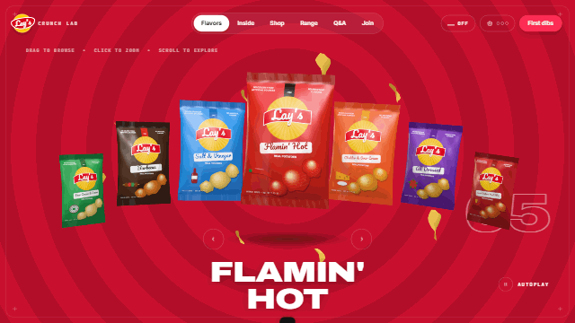</a>

<sub>Recorded from the live site: real WebGL bags on an arc, re-theming the page for each flavor. Click it to open the demo.</sub>

</div>

**Try these on the live site:**

| | |
|---|---|
| 🖱️ **Drag or swipe** the carousel | ⬅️➡️ **Arrows** step through flavors |
| 🔍 **Click the center bag** to zoom it, then press **Esc** | 🔊 **Sound** toggle in the header |
| ➕ **Add 3 bags** from the Wall to your box | 🎡 **Drag the wheel** on The Rack, then **Taste it** |

---

## 📸 Screenshots

All taken from the live deployment at 1600 × 900.

<table>
  <tr>
    <td width="50%">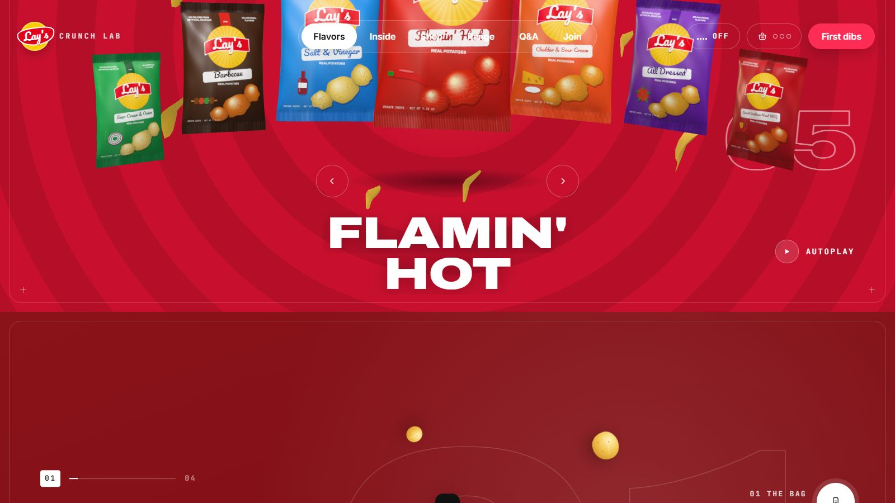<br><sub><b>Hero</b>: 3D bags on an arc, flavor rings</sub></td>
    <td width="50%">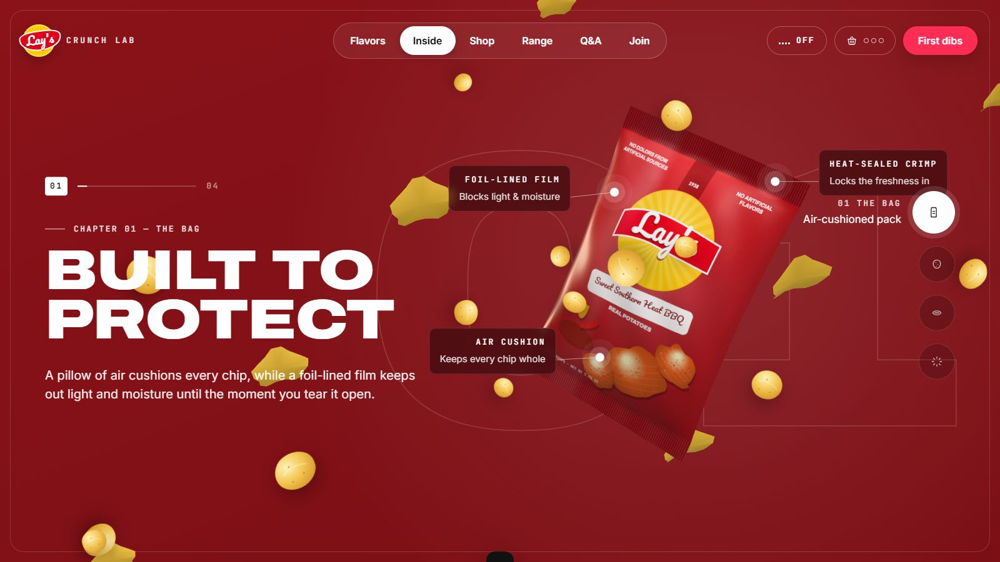<br><sub><b>Inside</b>: pinned story with live callouts</sub></td>
  </tr>
  <tr>
    <td>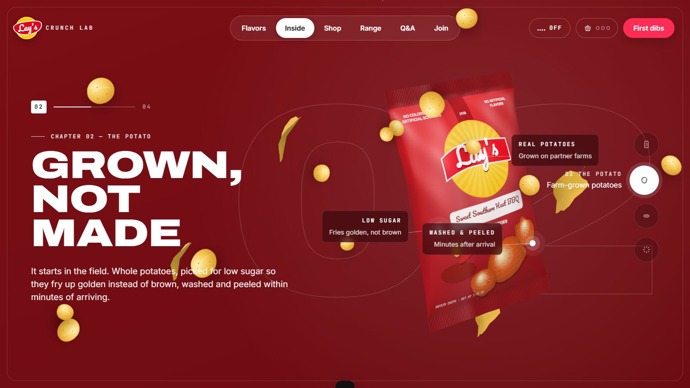<br><sub><b>Story</b>: chapter 2</sub></td>
    <td>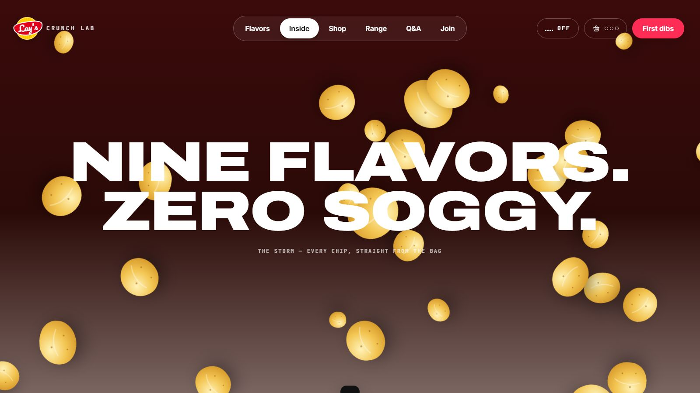<br><sub><b>The storm</b>: nine flavors, zero soggy</sub></td>
  </tr>
  <tr>
    <td>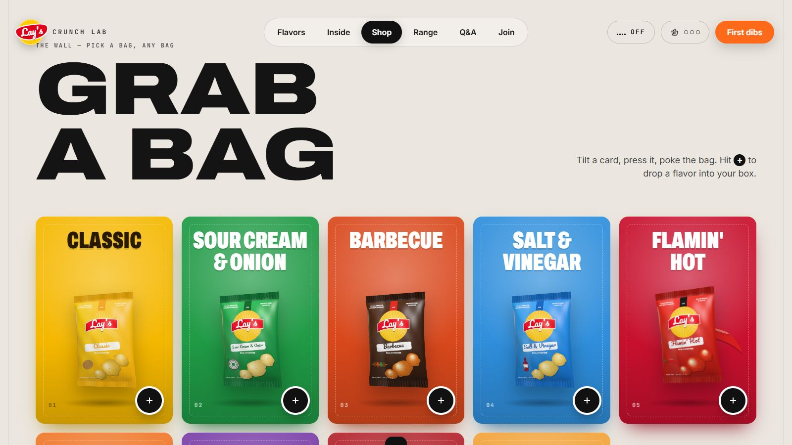<br><sub><b>The Wall</b>: grab a bag</sub></td>
    <td>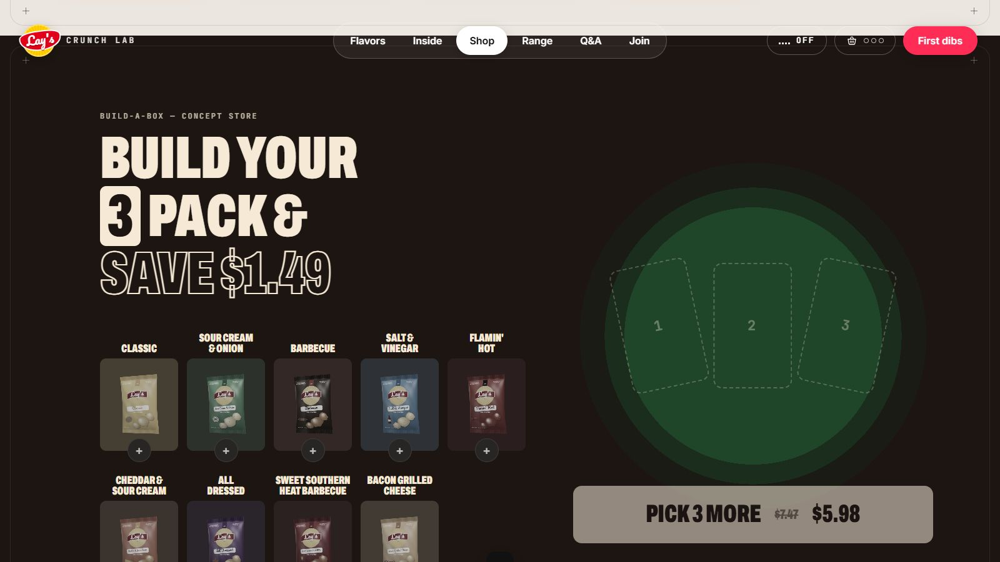<br><sub><b>Build-a-Box</b>: pick a 3-pack</sub></td>
  </tr>
  <tr>
    <td>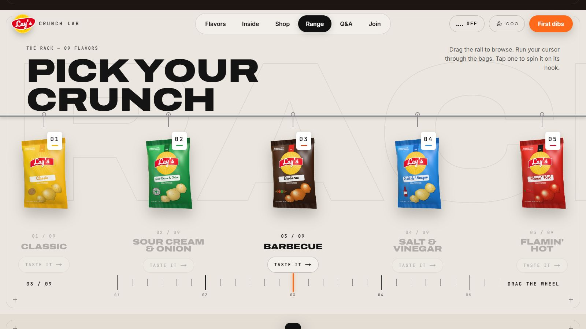<br><sub><b>The Rack</b>: drag the rail or the wheel</sub></td>
    <td>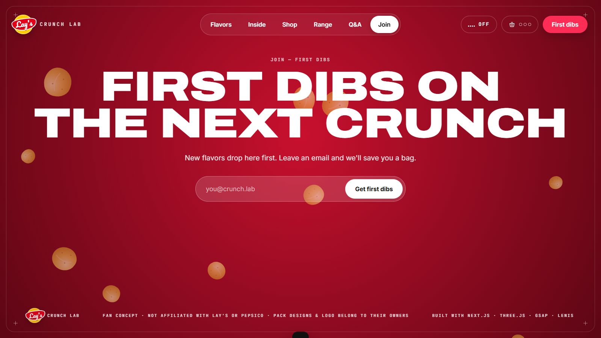<br><sub><b>Join</b>: first dibs</sub></td>
  </tr>
</table>

### 📱 On phones (390 px)

<table>
  <tr>
    <td>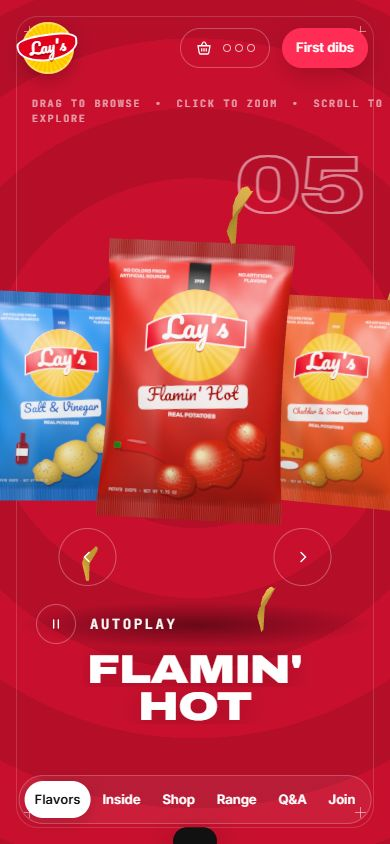</td>
    <td>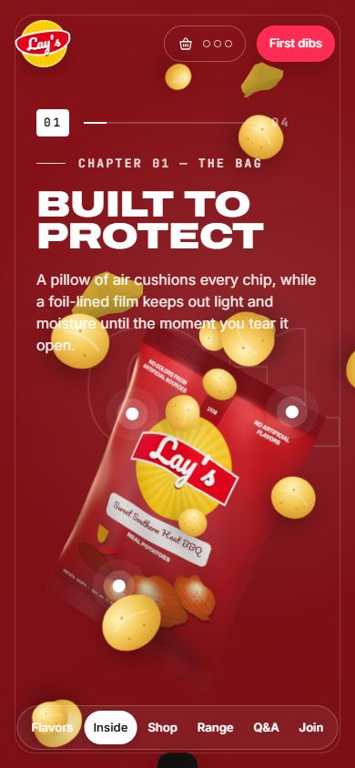</td>
    <td>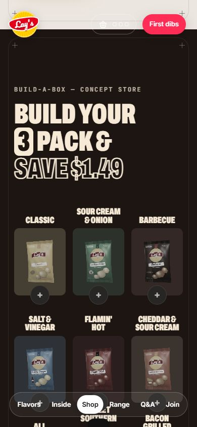</td>
  </tr>
  <tr>
    <td>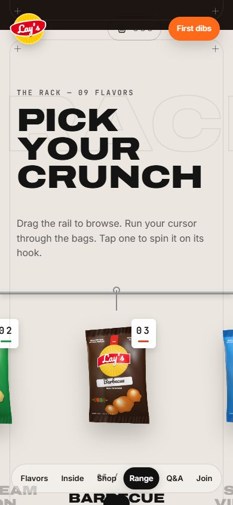</td>
    <td>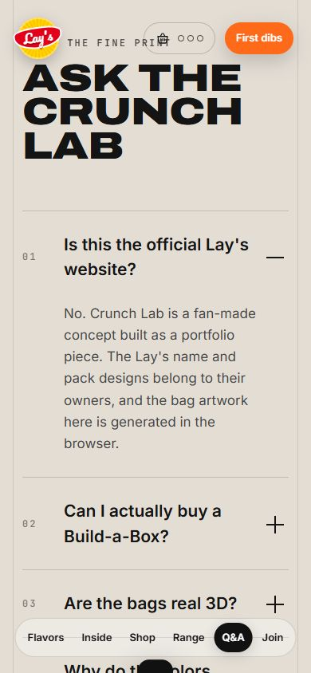</td>
    <td>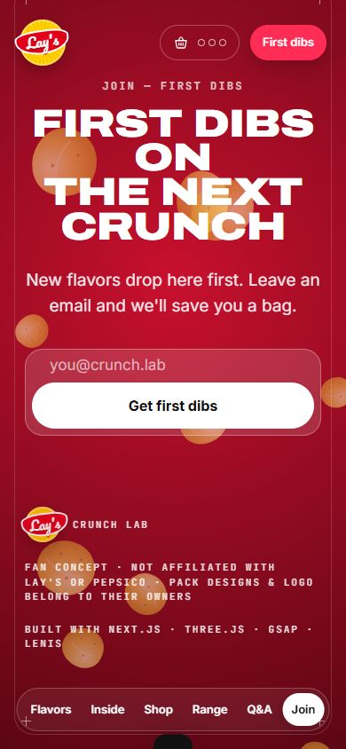</td>
  </tr>
</table>

---

## 💬 Prompts

This site was built with Claude Code from four prompts. They're listed in full in **[PROMPTS.md](PROMPTS.md)**, with notes on what each one produced.

```text
1. /clone-website https://github.com/alagappan567/lays-crunch-experience
2. i not have live site so build from that repos information and with those files
3. Yes, check it
4. deploy this on vercel and commit and push on https://github.com/Guru1315/Lays-ad-Site …
```

## 🛠️ How it works

- **The bags are generated, not photographed.** Pack art is drawn on canvas in the browser and wrapped on pillow-shaped meshes with crimped seals.
- **One renderer for the whole page.** A single WebGL renderer draws the hero and pre-renders the shop and Rack bag images while the loader runs, so shaders compile once.
- **Scroll is the timeline.** Lenis smooth scroll drives GSAP ScrollTrigger to pin the story chapters and move the 3D bag through them.
- **The page re-themes per flavor.** Each flavor sets CSS variables (color, deep, glow, ink), and the background rings sweep to the new colors from the center outward.
- **Tested in a real browser.** 17 automated interaction checks pass on the live site at desktop and phone width.

This repo holds the prompts, screenshots and recordings only. The site's source code isn't included.

## 🙏 Credits

- Concept, sections and pseudocode come from **[alagappan567/lays-crunch-experience](https://github.com/alagappan567/lays-crunch-experience)**. This is an independent rebuild made from that repo's public docs and screenshots.
- Built with [Claude Code](https://claude.com/claude-code).

> **Fan concept.** This site is not affiliated with Lay's or PepsiCo. The Lay's name, logo and pack designs belong to their owners. The store and sign-up are demos: nothing is sold and no emails are sent.
